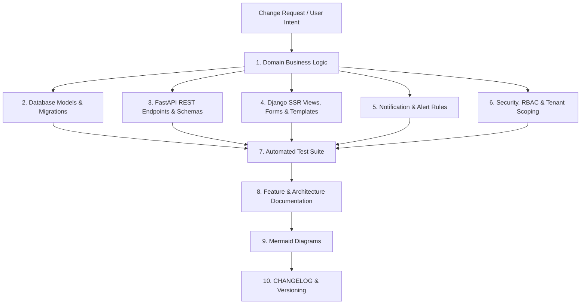

# Change Management & Living Documentation Protocol

> **BizFlow Change Management Framework**  
> *Authoritative standard for proposing, analyzing, executing, testing, and documenting system modifications.*

---

## 1. Principles of Living Change Management

1. **Synchronous Evolution**: Code, database migrations, API schemas, UI templates, test suites, and documentation evolve simultaneously in the same pull request or staged commit.
2. **Impact-First Mindset**: Before any code is edited, an impact analysis is conducted across the entire architecture.
3. **No Undocumented Changes**: Any feature, business rule, database column, API parameter, or notification behavior modified without updating its corresponding documentation is considered **incomplete** and violates the Definition of Done.
4. **Single Source of Truth**: Changes are recorded in their canonical locations first, then referenced by downstream artifacts without manual contradictory duplication.

---

## 2. Change Impact Analysis Process

Whenever a modification is proposed or requested, developers and AI agents must trace its cascading impacts through the 10-layer architectural funnel:



### 12-Point Impact Checklist

Before making an edit, verify the impact on:
1. **Domain Services**: Does this alter calculations, validations, or transactional logic in `backend/domain/services/`?
2. **Database Models**: Are new fields, indexes, tables, or relationships needed in `apps/*/models.py`?
3. **Database Migrations**: Is a non-destructive Django migration required? Is it reversible?
4. **FastAPI Endpoints**: Are router handlers, Pydantic schemas, or status codes modified in `backend/api/`?
5. **Django Views & Forms**: Are SSR views, form fields, widgets, or templates affected in `backend/django_app/`?
6. **Navigation & Breadcrumbs**: Are sidebar links, tabs, or action buttons affected?
7. **Notification Engine**: Does this alter stock thresholds, due-date reminders, or SMS triggers?
8. **Permissions & RBAC**: Does this require new permissions or modify role access (Cashier, Manager, Admin)?
9. **Import & Export**: Does this change CSV/Excel export columns, headers, or upload parsing logic?
10. **Automated Tests**: What unit, integration, or API tests must be updated or created in `tests/`?
11. **Documentation**: Which files in `docs/` must be synchronized?
12. **Diagrams**: Do ER, DFD, Sequence, or Activity diagrams require updating in `docs/diagrams/`?

---

## 3. Change Request (CR) System

All significant architectural enhancements, schema adjustments, and business rule shifts are tracked using standardized Change Request entries.

### Change Request Template

```text
Change ID:            CR-XXXX
Date:                 YYYY-MM-DD
Feature / Module:     [Feature Name]
Type:                 [New Feature | Enhancement | Bug Fix | Refactor | Breaking Change]
Reason:               [Business rationale or user request]
Requested Change:     [Detailed description of what will be changed]
Affected Modules:     [List of affected Django apps, routers, services]
Database Impact:      [Schema changes, new tables, migrations]
API Impact:           [New/modified endpoints, Pydantic schemas]
UI Impact:            [New views, updated templates, design system adjustments]
Security Impact:      [Permission changes, authentication, CSRF]
Testing Impact:       [Test files created or updated, assertions added]
Documentation Impact: [docs/ files updated]
Migration Required:   [Yes / No, Migration Name]
Status:               [Proposed | In Progress | Completed | Superseded]
```

---

## 4. Change Request Registry

| Change ID | Date | Module | Type | Description | Status |
|---|---|---|---|---|---|
| **CR-0001** | 2026-09-28 | Core Scaffold | Architecture | Migration from Flask monolith to Django + FastAPI hybrid scaffold. | Completed |
| **CR-0002** | 2026-09-29 | Database | Foundation | Creation of 20+ core ORM models across 13 apps with multi-tenancy. | Completed |
| **CR-0003** | 2026-09-29 | Domain | Business Logic | Extraction of pure Python domain services (`SaleService`, `StockService`). | Completed |
| **CR-0004** | 2026-09-30 | Accounts | Security | Hybrid session & JWT auth with token revocation list (`RevokedToken`). | Completed |
| **CR-0005** | 2026-09-30 | Inventory | Feature | Product SKU, stock movements ledger, and category management. | Completed |
| **CR-0006** | 2026-10-01 | Sales | Feature | Sales invoices, line items, customer records, and receipt printing. | Completed |
| **CR-0007** | 2026-10-01 | Purchases | Feature | Vendor bills, supplier records, and inventory replenishment. | Completed |
| **CR-0008** | 2026-10-01 | UI | Design System | Royal Blue `#1E40AF` design tokens, responsive layout, minimal theme. | Completed |
| **CR-0009** | 2026-10-01 | Core | Export Engine | CSV & Excel (.xlsx) export utility with UTF-8 BOM encoding. | Completed |
| **CR-0010** | 2026-10-02 | Core | Hardening | Performance timing middleware, query prefetching, and logging filter. | Completed |
| **CR-0011** | 2026-10-02 | Sales / Purchases | Database | Added indexed `due_date` to `Sale` and `Purchase` (`sales.0002`, `purchases.0002`). | Completed |
| **CR-0012** | 2026-10-02 | Credit | Feature | Comprehensive Udhaar / Credit Management (Receivables, Payables, Ledgers). | Completed |
| **CR-0013** | 2026-10-02 | Credit | API | Mounted `/api/v1/credit/` endpoints for summaries, dues, and ledgers. | Completed |
| **CR-0014** | 2026-10-03 | Cheques | Feature Spec | Defined 7-day, 3-day, 2-day, 1-day, and due-today cheque clearing reminders. | Completed |
| **CR-0015** | 2026-10-03 | Documentation | Architecture | Implemented centralized living documentation tree, traceability matrix, and diagrams. | Completed |
| **CR-0016** | 2026-10-05 | Sales / Purchases | UI / UX | Inline quick-add modals for companies, suppliers, products, and form state persistence. | Completed |
| **CR-0017** | 2026-10-05 | Credit / Accounting | Feature / UI | Standardized Debit (Dr) and Credit (Cr) double-entry indicators, redesigned party ledger suite, multi-tenant scoping. | Completed |
| **CR-0018** | 2026-10-08 | Performance / UI | Optimization | Minimal UI/UX, N+1 query elimination via prefetch cache, date boundary scoping, asset loading optimization (Part 20). | Completed |
| **CR-0019** | 2026-10-09 | Sales / Purchases | Feature | Granular transaction & due date controls, universal date range filtering, interactive BS/AD date switcher and dual date badges (Part 21). | Completed |
| **CR-0020** | 2026-10-09 | Analytics / AI | Feature | Pure-Python `AnalyticsService`, local deterministic decision advisor & hybrid AI decision support, `/api/v1/analytics/` endpoints, and interactive reports dashboard (Part 22). | Completed |
| **CR-0021** | 2026-10-09 | Accounts / Analytics | Feature | Admin user immediate visibility, online/offline presence tracking middleware, cash received vs revenue distinction, low-stock reorder suggestions, and analytics CSV/print suite (Part 23). | Completed |
| **CR-0022** | 2026-10-10 | Accounts / Security | Feature | Google OAuth2 OpenID Connect social authentication, user auto-provisioning, `/api/v1/auth/google` endpoints, centralized RBAC Permission enum, and granular view/API authorization decorators (Part 24). | Completed |
| **CR-0023** | 2026-10-10 | Accounts / UI | Security / UX | Role-based UI feature filtering and view protection across Customer, Cashier, Staff, Manager, and Admin roles (hiding internal wholesale prices, executive analytics, and unpermitted navigation links). | Completed |

---

## 5. Documentation Update Checklist

For every completed change, tick the affected items:

```text
[ ] docs/PRD.md                   - Update system scope, functional requirements
[ ] docs/features/<feature>.md    - Update 16-point feature specification
[ ] docs/architecture/*.md        - Update system design, module map, integrations
[ ] docs/database/*.md            - Update tables, relationships, migration history
[ ] docs/api/*.md                 - Update endpoints, request/response models, auth
[ ] docs/ui/*.md                  - Update design system tokens, components, views
[ ] docs/security/*.md            - Update security policies, roles, threat model
[ ] docs/testing/*.md             - Update test strategy, test matrix, coverage
[ ] docs/TRACEABILITY_MATRIX.md   - Link Requirement ID to Code, API, Tests, Docs
[ ] docs/diagrams/*.md            - Update Mermaid diagrams (ER, Sequence, Activity)
[ ] CHANGELOG.md                  - Add entry under current version with date
[ ] README.md                     - Update top-level badges, features, and run instructions
```

---

## 6. Versioning Policy

BizFlow enforces Semantic Versioning (`MAJOR.MINOR.PATCH`):

- **MAJOR (X.0.0)**: Incompatible architectural shifts, database breaking redesigns, or legacy deprecations.
- **MINOR (0.X.0)**: New features, major module additions, non-breaking schema additions (e.g. `CreditService`, `apps/credit/`).
- **PATCH (0.0.X)**: Bug fixes, UI polish, performance optimizations, documentation synchronization.

---

## 7. 13-Step Future Modification Workflow

Whenever a request is received to add, modify, rename, or remove any functionality, execute these steps sequentially:

1. **Understand Intent**: Clarify requirements, acceptance criteria, and edge cases.
2. **Locate Existing Assets**: Identify relevant code files, templates, services, and docs.
3. **Execute Impact Analysis**: Run through the 12-point impact checklist.
4. **Draft Implementation Plan**: Identify exact files to modify or create.
5. **Implement Domain Logic**: Update or create services in `backend/domain/services/`.
6. **Update Relational Schema**: Modify models and generate migrations (`makemigrations`).
7. **Update API Layer**: Update FastAPI routers, schemas, dependencies in `backend/api/`.
8. **Update Web UI**: Update Django views, forms, and templates in `backend/django_app/`.
9. **Update Test Suite**: Add or modify pytest test cases in `tests/`.
10. **Run Verification**: Ensure all tests pass with 100% green status (`python -m pytest`).
11. **Synchronize Documentation**: Update affected documents in `docs/` and `docs/features/`.
12. **Update Diagrams & Changelog**: Update Mermaid diagrams, log in `CHANGELOG.md` and `docs/CHANGE_MANAGEMENT.md`.
13. **Report Execution**: Provide the user with a concise summary of changes and updated artifacts.
