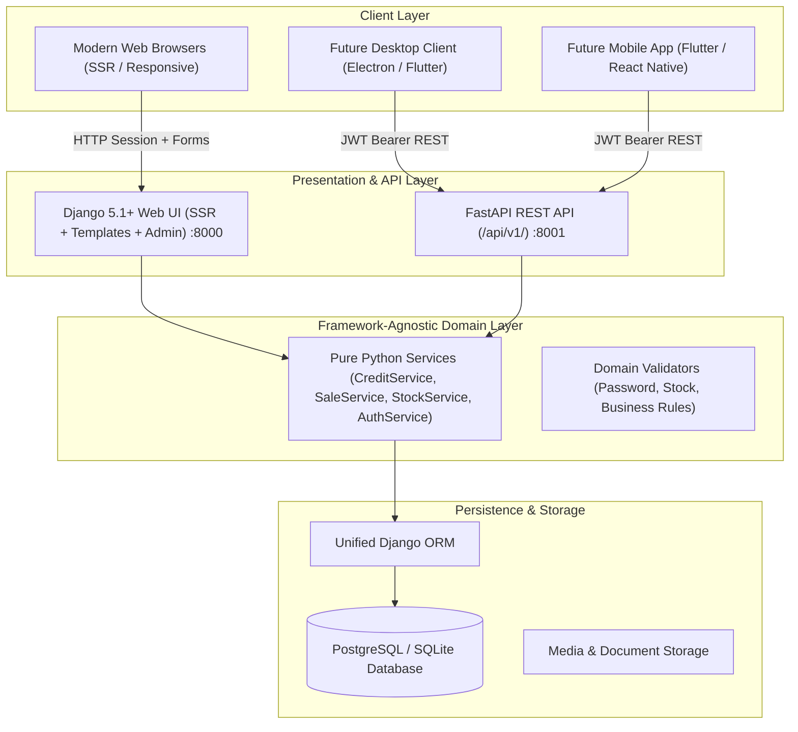

# System Architecture Overview

> **BizFlow Hybrid Architecture**  
> *Django 5.1+ (SSR Web UI, Admin & Migrations) + FastAPI (High-Performance REST API) + Pure Domain Services.*

---

## 1. High-Level Architecture Topology

BizFlow utilizes a state-of-the-art hybrid Python architecture designed for high availability, zero business logic duplication, and flexible multi-client support:

---

## 2. Core Architectural Pillars

### A. Unified Single ORM
Both Django and FastAPI run against the **same shared relational database schema managed exclusively by Django ORM and migrations**.
- At startup, FastAPI initializes the Django ORM via `django.setup()` inside `backend/api/main.py`.
- No secondary ORM (such as SQLAlchemy or Tortoise) is permitted.

### B. Pure Framework-Agnostic Domain Layer
- Resides in `backend/domain/services/`.
- Domain services accept primitive data types, Pydantic schemas, or dataclasses and return domain objects or dictionaries.
- Domain services **never** receive framework HTTP request objects (`django.http.HttpRequest` or `fastapi.Request`).
- This guarantees 100% code reuse between the Django web interface and the FastAPI mobile/desktop API.

### C. Multi-Tenancy Scoping
- Every business record is scoped to `companies.Company`.
- Middleware attaches `active_company` to the request context.
- Querysets filter by company ID to ensure strict data partitioning.

---

## 3. Communication Protocols

| Channel | Consumer | Protocol | Port | Authentication |
|---|---|---|---|---|
| **Web UI** | Cashiers, Managers, Store Admins | HTTP / HTML5 SSR | 8000 | Secure HTTP-Only Session Cookies + CSRF |
| **Admin Portal** | Super Administrators | HTTP / Django Admin | 8000 | Staff Session Auth |
| **REST API** | Desktop, Mobile, External Integrations | HTTPS / JSON REST | 8001 | JWT Bearer Tokens (`Authorization: Bearer <token>`) |
| **API Docs** | Developers, Integrators | OpenAPI / Swagger UI | 8001 | Interactive Docs at `/api/docs` |
