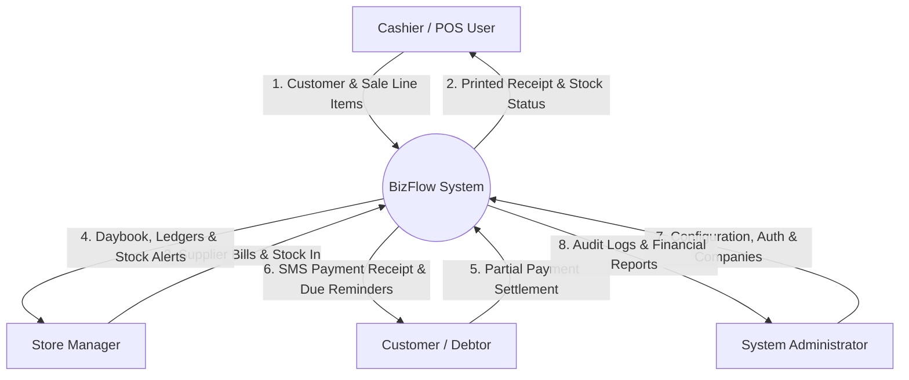
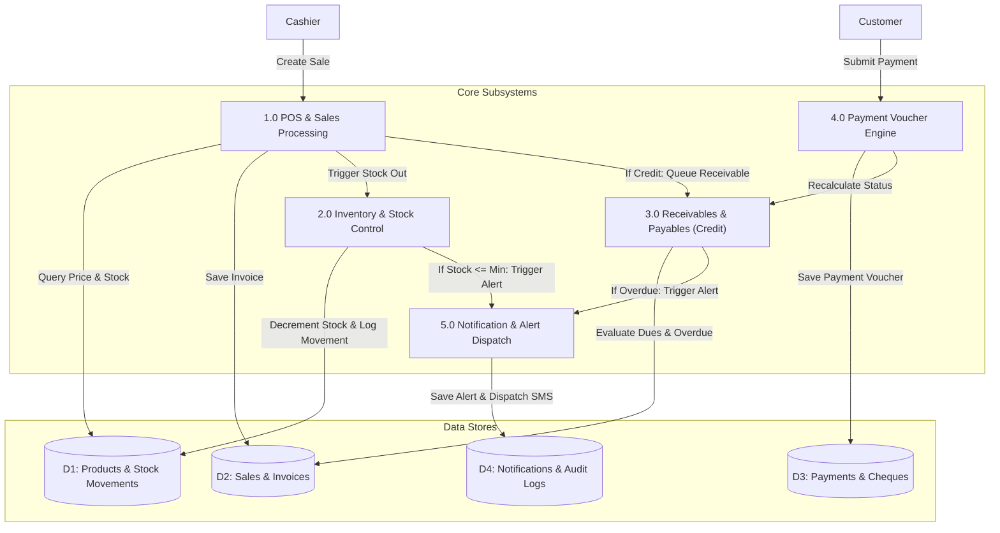

# Visual Architecture: Data Flow Diagrams (DFD)

> **BizFlow Process Data Flows**  
> *Context Level 0 and Level 1 Functional Data Flow Diagrams rendered in Mermaid.*

---

## 1. Context Level 0 DFD

---

## 2. Level 1 Process Breakdown DFD

