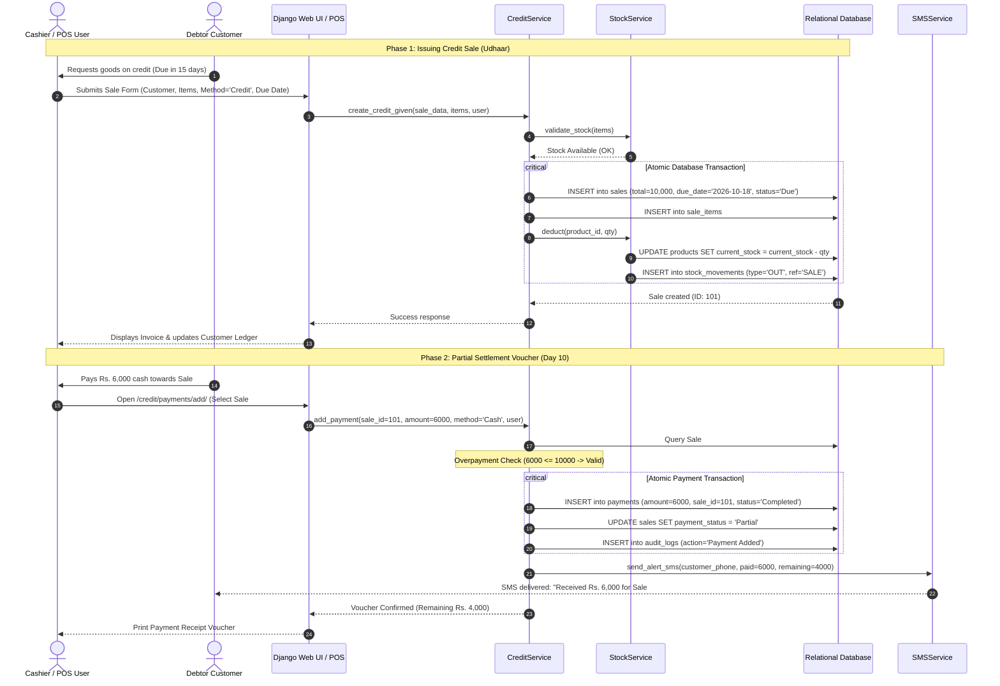
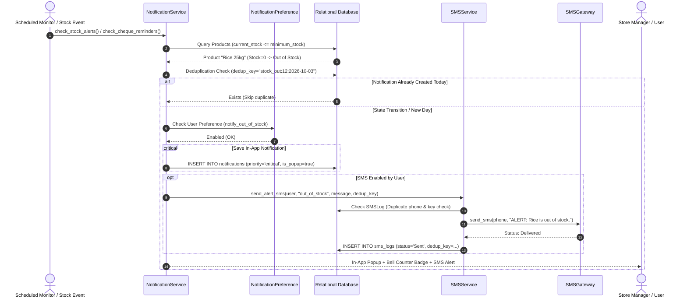

# Visual Architecture: Sequence Diagrams

> **BizFlow Transaction Sequence**  
> *Udhaar Credit Sale, Partial Settlement, and Central Business Notification Lifecycle rendered in Mermaid.*

---

## 1. Credit Sale and Partial Settlement Sequence

---

## 2. Central Business Notification & SMS Alert Dispatch Sequence

