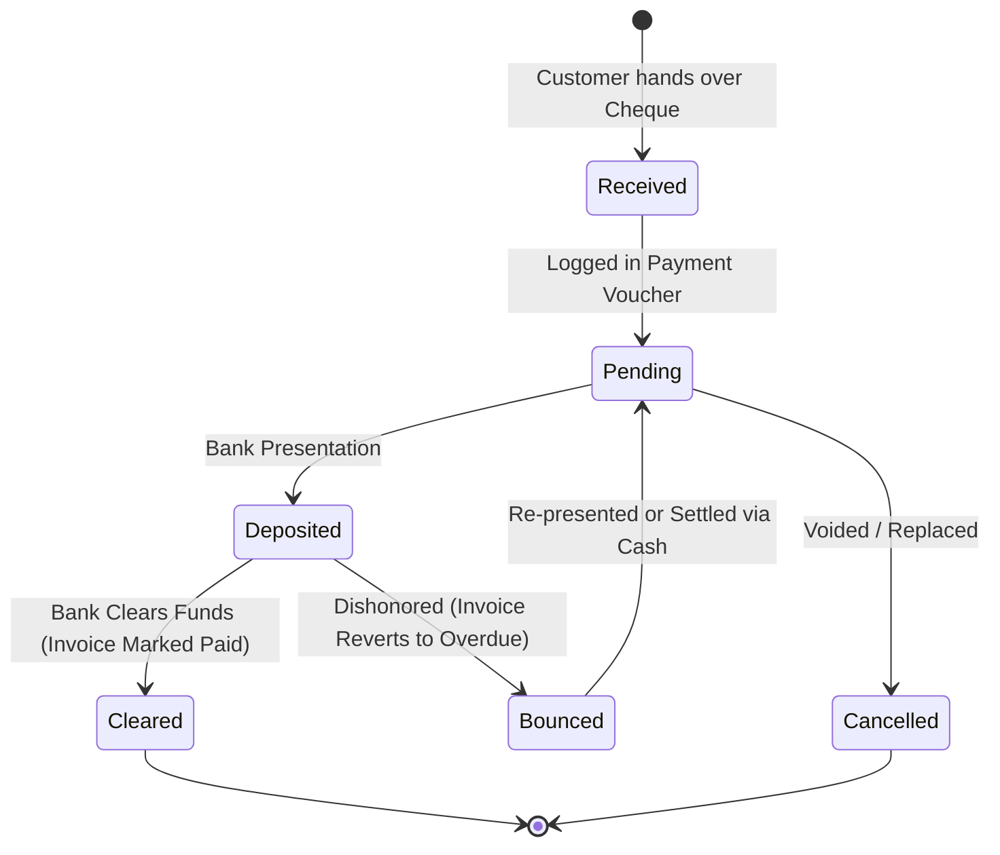

# Feature: Cheque Lifecycle & Clearance Management

> **Identifier**: `FEAT-CHEQUE-001`  
> **Module**: `backend/django_app/apps/sales/models.py`, `backend/django_app/apps/transactions/models.py` & Notifications  
> **Status**: Production Ready  
> **Version**: 1.5.0

---

## 1. Purpose
Provides dedicated lifecycle tracking for post-dated and current bank cheques (both issued to vendors and received from customers), including status transitions (Pending, Cleared, Bounced, Cancelled) and dynamic time-based reminders to prevent cheque bounce penalties and cash flow disruption.

---

## 2. Scope
- **Included**: Inward cheque receipt capture (Cheque #, Bank, Amount, Date, Drawer), outward cheque issuance logging, clearing status workflows, automated multi-stage reminder schedules (7, 3, 2, 1 days before, due today, overdue), and bounce penalty tracking.
- **Out of Scope**: Direct automated bank clearing house (ACH) electronic clearing API protocols.

---

## 3. User Roles & Permissions
- **Super Admin & Company Admin**: Mark cheques as cleared, bounced, or cancelled; alter bank accounts.
- **Manager**: Record received/issued cheques, deposit to bank, view maturity alerts.
- **Cashier**: Receive physical customer cheques at POS and record cheque number, date, and bank name.

---

## 4. Business Rules
- **Rule CHEQ-BR-001 (Unique Cheque Identifier)**: Cheque numbers must be stored alongside bank name to form a unique tuple `(cheque_number, bank_name)` per company.
- **Rule CHEQ-BR-002 (Maturity Reminder Intervals)**: The notification engine dispatches alerts based on the interval:
  $$\Delta = \text{cheque\_date} - \text{today}$$
  - $\Delta = 7 \text{ days} \implies \text{Weekly Forward Alert}$
  - $\Delta = 3 \text{ days} \implies \text{3-Day Advance Notice}$
  - $\Delta = 2 \text{ days} \implies \text{2-Day High-Priority Reminder}$
  - $\Delta = 1 \text{ day} \implies \text{Tomorrow Maturity Alert}$
  - $\Delta = 0 \text{ days} \implies \text{Due Today / Action Required Alert}$
  - $\Delta < 0 \text{ and status == 'Pending'} \implies \text{Overdue / Dishonor Risk Alert}$
- **Rule CHEQ-BR-003 (Status Transitions)**:
  - `Pending`: Cheque in hand or issued, awaiting maturity.
  - `Deposited`: Submitted to bank for clearing.
  - `Cleared`: Funds transferred; invoice status updated to `Paid`.
  - `Bounced`: Insufficient funds; invoice reverts to `Due` / `Overdue` and audit alert logged.
  - `Cancelled`: Voided prior to presentation.

---

## 5. User Workflow

---

## 6. Database Relationships
- Stored on `apps.sales.models.Sale` (`cheque_number`, `cheque_date`).
- Stored on `apps.purchases.models.Purchase` (`cheque_number`, `cheque_date`).
- Stored on `apps.sales.models.Payment` (`cheque_number`, `cheque_date`, `bank_name`).
- Stored on `apps.transactions.models.Transaction` (`cheque_number`, `cheque_date`, `bank_account`).

---

## 7. API Endpoints
- `GET /api/v1/credit/payments?method=Cheque`: List all cheque transactions.
- `GET /api/v1/notifications/cheques`: Retrieve cheques maturing within 7 days.
- `POST /api/v1/credit/payments`: Record incoming or outgoing cheque voucher.
- `POST /api/v1/cheques/{id}/clear`: Mark cheque as cleared.
- `POST /api/v1/cheques/{id}/bounce`: Mark cheque as bounced with penalty note.

---

## 8. UI Pages & Components
- **Cheque Payment Filter (`/credit/payments/?method=Cheque`)**: Filterable table showing maturing cheques, bank names, drawer, and due dates.
- **Cheque Reminder Card (Dashboard `/dashboard/`)**: High-priority alert banner listing cheques due within 48 hours.
- **Cheque Clearance Modal**: One-click action to confirm bank clearing or register bounce notice.

---

## 9. Notifications & Alerts
- **2-Day Cheque Reminder**: High-priority notification displayed in the top bar to remind manager to deposit cheque or verify bank balance.
- **Due Today Cheque Alert**: Modal or sticky banner on cashier screen.
- **Cheque Bounced Alert**: Generates an urgent security alert in `audit.Notification` and marks customer account with warning flag.

---

## 10. Security Considerations
- Voiding or bouncing a cheque creates an immutable entry in `AuditLog`.
- Cheque numbers are sanitized to prevent script injection in reporting screens.

---

## 11. Validation Rules
- `cheque_number` must be between 4 and 64 characters.
- `cheque_date` must not exceed 90 days in the past (stale cheque rule).
- `bank_name` cannot be blank if method is `Cheque`.

---

## 12. Error Handling
- `StaleChequeError`: Raised if cheque date is older than 90 days without manager override.
- `InvalidChequeStatusError`: Raised if attempting to clear an already cancelled cheque.

---

## 13. Import/Export Behavior
- **Export**: Maturing and uncleared cheque registers exportable to CSV and Excel for bank reconciliation.

---

## 14. Testing Requirements
- Unit tests: `tests/test_credit_management.py::test_cheque_payment_recording`.
- Integration tests: `tests/django/test_cheque_reminders.py`.
- Form validation tests: `tests/test_django_web_application.py::test_cheque_form_fields`.

---

## 15. Related Features
- [`payments.md`](file:///e:/project/Business%20Management%20System/docs/features/payments.md): Primary voucher model storing cheque records.
- [`notifications.md`](file:///e:/project/Business%20Management%20System/docs/features/notifications.md): Dispatches reminder alerts according to maturity schedule.
- [`receivables-payables.md`](file:///e:/project/Business%20Management%20System/docs/features/receivables-payables.md): Adjusts party credit ledger upon clearance or bounce.

---

## 16. Change History
- **2026-09-30 (v1.0.0)**: Cheque fields added to Sales, Purchases, and Payments.
- **2026-10-02 (v1.4.0)**: Enhanced with Cheque filter in payments and vouchers hub.
- **2026-10-03 (v1.5.0)**: Added dynamic 7/3/2/1/0-day reminder rules and standardized specification.
