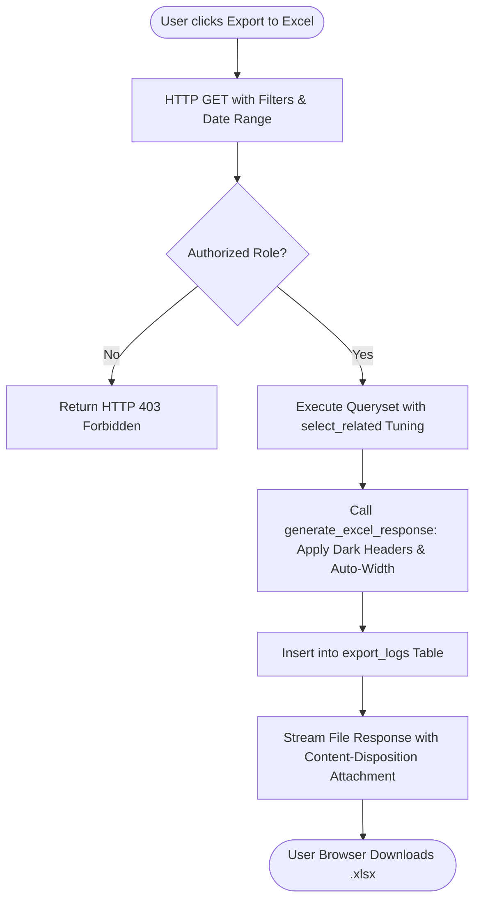

# Feature: Import, Export & File Management Engine

> **Identifier**: `FEAT-IMPORT-001`  
> **Module**: `backend/django_app/apps/core_app/exports.py` & `backend/django_app/apps/audit/models.py`  
> **Status**: Production Ready  
> **Version**: 1.5.0

---

## 1. Purpose
Provides high-performance data interchange services, allowing users to export large financial ledgers, inventory catalogs, and invoice registers into structured CSV and styled Excel (`.xlsx`) spreadsheets, and bulk import master data with multi-stage schema validation and file sanitization.

---

## 2. Scope
- **Included**: UTF-8 BOM-encoded CSV generation, formatted Excel spreadsheet styling (headers, column auto-width, cell formats via OpenPyXL), streaming file responses, uploaded file parser (CSV, XLSX) with 10MB guard, filename sanitization against path traversal, and export audit logging (`ExportLog`).
- **Out of Scope**: Direct automated FTP file sync (future integration scope).

---

## 3. User Roles & Permissions
- **Super Admin & Company Admin**: Export sensitive financial statements, profit & loss, and audit logs.
- **Manager**: Export inventory lists, sales registers, purchase registers, and party ledgers; execute bulk product imports.
- **Cashier**: Export daily shift sales summary (restricted from downloading entire customer database).

---

## 4. Business Rules
- **Rule EXP-BR-001 (UTF-8 BOM Encoding)**: All CSV exports must prepend `\ufeff` (UTF-8 Byte Order Mark) to ensure seamless opening in Microsoft Excel without non-ASCII character corruption.
- **Rule EXP-BR-002 (Styled Excel Layout)**: All Excel exports generated via OpenPyXL must format header row with Dark Slate fill (`#1E293B`), white bold text, auto-fit column widths with padding, and proper numerical alignment.
- **Rule EXP-BR-003 (Upload Security Guard)**: Any uploaded import file exceeding 10MB ($10 \times 1024 \times 1024$ bytes) must be rejected immediately before parsing into memory.
- **Rule EXP-BR-004 (Path Traversal Protection)**: Filenames must be sanitized using `os.path.basename` to prevent directory traversal vulnerabilities.
- **Rule EXP-BR-005 (Export Auditing)**: Every downloaded export generates an immutable entry in `audit.ExportLog` recording user, module, format, record count, and timestamp.

---

## 5. User Workflow

---

## 6. Database Relationships
- Integrates with `apps.audit.models.ExportLog` (`user`, `module`, `format`, `record_count`, `filters`, `success`, `created_at`).

---

## 7. API Endpoints
- `GET /api/v1/reports/export/csv`: Export financial report data.
- `POST /api/v1/inventory/import`: Upload CSV/XLSX for bulk product creation.

---

## 8. UI Pages & Components
- **Export Toolbar Component**: Standardized button group rendered on tables (CSV Export, Excel Export, Print).
- **Bulk Import Modal**: Drag-and-drop file upload zone with sample template download link and progress bar.
- **Export Log History (`/admin/audit/exportlog/`)**: Administrative audit of past file downloads.

---

## 9. Notifications & Alerts
- **Export Complete Toast**: Notifies user when large file download commences.
- **Import Validation Error Modal**: Displays table of row numbers and specific field errors if an imported file has invalid data.

---

## 10. Security Considerations
- Memory exhaustion defense via 10MB file ceiling (`max_size = 10 * 1024 * 1024`).
- CSV Formula Injection defense (disables execution of `=cmd|...` formulas).
- Strictly scoped to user's active tenant company.

---

## 11. Validation Rules
- Supported extensions: `.csv`, `.xlsx`, `.xls`.
- CSV files must be decodable with `utf-8-sig`, `utf-8`, or `latin-1`.
- Uploaded Excel workbooks must contain at least one non-empty worksheet.

---

## 12. Error Handling
- Returns `(None, None, "File size exceeds maximum allowed limit of 10MB.")` on oversized files.
- Returns `(None, None, "Uploaded Excel sheet is empty.")` on blank sheets.
- Returns `(None, None, "Invalid file format.")` on unauthorized extensions.

---

## 13. Import/Export Behavior
- Supported core export modules:
  - Inventory Catalog (`/inventory/export/excel/`)
  - Financial Summary (`/reports/summary/export/csv/`)
  - Receivables & Customer Dues (`/credit/reports/export/csv/`)
  - Supplier Payables Register
  - Daybook Daily Transactions

---

## 14. Testing Requirements
- Unit tests: `tests/test_performance_and_security.py`:
  - `test_csv_export_utf8_bom`
  - `test_excel_export_styling`
  - `test_upload_file_parser_csv`
  - `test_upload_file_parser_xlsx`
  - `test_upload_parser_file_size_limit`

---

## 15. Related Features
- [`inventory.md`](file:///e:/project/Business%20Management%20System/docs/features/inventory.md): Bulk product import and stock exports.
- [`receivables-payables.md`](file:///e:/project/Business%20Management%20System/docs/features/receivables-payables.md): Ledger and overdue statements export.
- [`reports.md`](file:///e:/project/Business%20Management%20System/docs/architecture/modules.md): Financial daybook and summary exports.

---

## 16. Change History
- **2026-10-01 (v1.2.0)**: Initial CSV and OpenPyXL utilities implemented in `exports.py`.
- **2026-10-02 (v1.3.0)**: Added 10MB security boundary, filename sanitization, and `ExportLog`.
- **2026-10-03 (v1.5.0)**: Standardized to 16-point feature specification.
