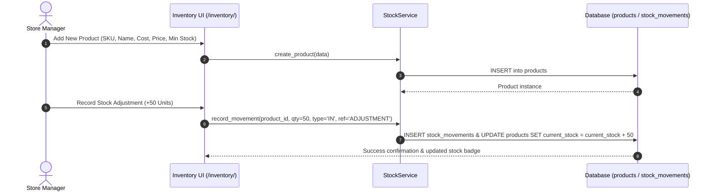

# Feature: Inventory Management & Stock Control

> **Identifier**: `FEAT-INV-001`  
> **Module**: `backend/django_app/apps/inventory` & `backend/domain/services/stock_service.py`  
> **Status**: Production Ready  
> **Version**: 1.5.0

---

## 1. Purpose
Provides real-time product tracking, SKU catalog management, multi-tier categorization, automated inward/outward stock movement auditing, valuation tracking, and low-stock warning triggers to prevent stockouts and inventory shrinkage.

---

## 2. Scope
- **Included**: Product CRUD with unique SKU generation, category hierarchy, stock movement ledger (IN, OUT, ADJUSTMENT, CANCEL), current stock caching on product entity, stock valuation metrics, and low-stock threshold monitoring.
- **Out of Scope**: Multi-warehouse geospatial routing and RFID scanner firmware integrations (handled in future desktop/mobile specs).

---

## 3. User Roles & Permissions
- **Super Admin & Company Admin**: Full permissions (Create, Edit, Delete, Stock Adjustments, Valuation reports).
- **Manager**: Create, Edit, View, Stock Inward/Outward movements.
- **Cashier**: View catalog, check stock availability during checkout (Read-only).
- **Seller**: Access restricted strictly to products linked to their seller ID.

---

## 4. Business Rules
- **Rule INV-BR-001 (Unique SKU)**: Every product must have an immutable, unique SKU per tenant company.
- **Rule INV-BR-002 (Non-Negative Stock Checkout)**: Sales cannot proceed if `product.current_stock < requested_quantity` unless explicit backordering override is granted.
- **Rule INV-BR-003 (Valuation Calculation)**: Total inventory valuation is dynamically calculated as:
  $$\text{Stock Valuation} = \sum (\text{Product.current\_stock} \times \text{Product.purchase\_price})$$
- **Rule INV-BR-004 (Stock Adjustment Audit)**: Any manual stock adjustment requires an accompanying `StockMovement` entry and `AuditLog` entry detailing the user, reason, and delta.
- **Rule INV-BR-005 (Alert Thresholds)**:
  - If $\text{current\_stock} \le \text{minimum\_stock}$ and $\text{current\_stock} > 0 \implies \textbf{Low Stock Alert}$.
  - If $\text{current\_stock} == 0 \implies \textbf{Out of Stock / Critical Alert}$.

---

## 5. User Workflow

---

## 6. Database Relationships
- `Category` (`categories`): One-to-Many with `Product`. (`on_delete=models.RESTRICT`).
- `Product` (`products`):
  - Belongs to `Company` (`companies.Company`, nullable for multi-tenant isolation).
  - Belongs to optional `Seller` (`companies.Seller`).
  - One-to-Many with `StockMovement` (`on_delete=models.CASCADE`, related_name `stock_movements`).
  - Referenced by `SaleItem` and `PurchaseItem`.
- `StockMovement` (`stock_movements`): Tracks `movement_type` (IN, OUT), `quantity`, `reference_type` (SALE, PURCHASE, ADJUSTMENT), `reference_id`, and timestamp.

---

## 7. API Endpoints
- `GET /api/v1/inventory/products`: List products with pagination, search, category filter.
- `POST /api/v1/inventory/products`: Create new product (Manager+).
- `GET /api/v1/inventory/products/{id}`: Detailed product info and stock movements.
- `PUT /api/v1/inventory/products/{id}`: Update product specifications.
- `GET /api/v1/inventory/low-stock`: Retrieve products at or below `minimum_stock`.
- `GET /api/v1/inventory/valuation`: Summary of stock count and monetary valuation.

---

## 8. UI Pages & Components
- **Product List (`/inventory/products/`)**: Interactive table with SKU badges, category filters, stock level color indicators (green/amber/red), search, and Excel export.
- **Product Form (`/inventory/products/create/`, `/edit/<id>/`)**: Form with SKU auto-generator, cost/selling price calculator, and tax selector.
- **Category Manager (`/inventory/categories/`)**: Modal-based category creation and hierarchy viewer.
- **Stock Movement Ledger (`/inventory/movements/`)**: Paginated audit table showing chronological IN/OUT changes with source invoice hyperlinks.

---

## 9. Notifications & Alerts
- **Low Stock In-App Alert**: Dispatched to dashboard notification center when product dips below `minimum_stock`.
- **Critical Stock-Out Warning**: Red banner alert rendered upon checkout if quantity reaches 0.
- **Stock Adjustment Notification**: Logged in `audit.AuditLog` with before/after counts.

---

## 10. Security Considerations
- Multi-tenant tenant scoping enforced on all querysets (`filter(company=request.user.active_company)`).
- SQL injection prevention via Django ORM parameterized queries.
- CSRF protection enabled on all product creation and adjustment POST forms.

---

## 11. Validation Rules
- `purchase_price` and `selling_price` must be $\ge 0.00$.
- `selling_price` must normally be $\ge \text{purchase\_price}$ (warns if negative margin detected).
- `minimum_stock` must be an integer $\ge 0$.
- `sku` must contain alphanumeric characters, hyphens, or underscores only.

---

## 12. Error Handling
- `ProductNotFoundError`: Raised if product ID is invalid (HTTP 404).
- `InsufficientStockError`: Raised by `SaleService` if checkout quantity exceeds `current_stock` (HTTP 400).
- `DuplicateSKUError`: Raised if SKU exists within the active company (HTTP 409).

---

## 13. Import/Export Behavior
- **Export**: Full product catalog exportable to CSV and styled Excel (`.xlsx`) via `/inventory/export/excel/` with column headers: `SKU`, `Name`, `Category`, `Unit`, `Cost`, `Selling Price`, `Current Stock`, `Stock Value`.
- **Import**: Bulk upload parser supports CSV and XLSX with 10MB file size limit, schema validation, and row-by-row error reporting.

---

## 14. Testing Requirements
- Unit tests: `tests/test_shared_business_logic.py::test_product_creation`, `test_stock_movement`, `test_stock_valuation`.
- Web UI tests: `tests/test_django_web_application.py::test_product_list_view`, `test_category_crud`.
- API tests: `tests/api/test_inventory.py`.

---

## 15. Related Features
- [`sales.md`](file:///e:/project/Business%20Management%20System/docs/features/sales.md): Decrements stock upon invoice completion.
- [`purchases.md`](file:///e:/project/Business%20Management%20System/docs/features/purchases.md): Increments stock upon receiving supplier bills.
- [`notifications.md`](file:///e:/project/Business%20Management%20System/docs/features/notifications.md): Handles notification delivery for low/out-of-stock events.

---

## 16. Change History
- **2026-09-30 (v1.0.0)**: Initial product model and stock movements migrated from Flask monolith.
- **2026-10-02 (v1.3.0)**: Query optimization (`select_related`) applied to eliminate N+1 bottlenecks.
- **2026-10-03 (v1.5.0)**: Converted to living documentation standard with 16-point specification.
