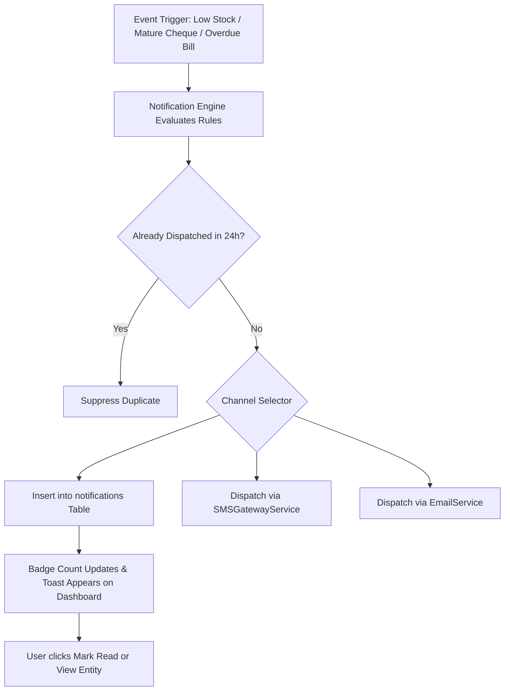

# Feature: Notification Engine & Alert Matrix

> **Identifier**: `FEAT-NOTIFY-001`  
> **Module**: `backend/django_app/apps/audit/models.py` (Notification) & `backend/domain/services/`  
> **Status**: Production Ready  
> **Version**: 1.5.0

---

## 1. Purpose
Centralizes all multi-channel operational, financial, and inventory alerts across the system to ensure business stakeholders receive proactive, actionable intelligence before critical events occur (such as stock depletion, overdue customer debt, or cheque bounce penalties).

---

## 2. Scope
- **Included**: In-App notifications, top navigation badge counter, Notification Center (`/dashboard/notifications/`), dismiss/mark-as-read workflows, modal popups for urgent alerts, and external SMS/email dispatch gateways.
- **Out of Scope**: Native push notifications for iOS/Android (handled in future mobile app specs).

---

## 3. User Roles & Permissions
- **Super Admin & Company Admin**: View company-wide system alerts, broadcast system announcements, configure alert threshold intervals.
- **Manager**: Receive stock shortage alerts, payment overdue notices, and cheque clearance reminders.
- **Cashier**: Receive stock replenishment alerts and customer credit limit notifications.

---

## 4. Business Rules & Notification Matrix

### A. Inventory & Stock Alerts
| Trigger Event | Mathematical Condition | Severity | Channels | Message Template |
|---|---|---|---|---|
| **Low Stock** | $0 < \text{current\_stock} \le \text{minimum\_stock}$ | Warning | In-App, Notification Center | `Product "{name}" (SKU: {sku}) is running low ({current_stock} left, min: {min_stock}).` |
| **Critical Stock** | $1 \le \text{current\_stock} \le \lceil 0.2 \times \text{minimum\_stock} \rceil$ | Urgent | In-App, Toast Popup | `CRITICAL: Product "{name}" has only {current_stock} units remaining.` |
| **Out of Stock** | $\text{current\_stock} == 0$ | Danger | In-App, Modal Popup | `STOCKOUT: Product "{name}" is completely out of stock. Sales halted.` |
| **Stock Received** | Purchase completed / Inward movement | Info | In-App | `Stock In: {qty} units of "{name}" added via Purchase #{bill_no}.` |
| **Stock Restored** | Manual positive stock adjustment | Info | In-App | `Stock Adjustment: Product "{name}" stock updated to {current_stock}.` |

### B. Financial & Credit Alerts
| Trigger Event | Mathematical Condition | Severity | Channels | Message Template |
|---|---|---|---|---|
| **Payment Due** | $\text{due\_date} - \text{today} == 2 \text{ days} \land \text{rem} > 0$ | Notice | In-App, Notification Center | `Payment Due Soon: Customer "{cust}" owes Rs. {rem} on Sale #{inv} in 2 days.` |
| **Payment Overdue** | $\text{due\_date} < \text{today} \land \text{rem} > 0$ | Danger | In-App, SMS, Notification Center | `OVERDUE: Invoice #{inv} for "{cust}" (Rs. {rem}) is overdue since {due_date}.` |
| **Receivable Due** | Customer credit mature within 48h | Warning | In-App, SMS | `Reminder: Rs. {rem} receivable from "{cust}" due on {due_date}.` |
| **Payable Due** | Vendor credit mature within 48h | Warning | In-App | `Payable Reminder: Rs. {rem} due to supplier "{supplier}" on {due_date}.` |

### C. Cheque Maturity Alerts
| Trigger Event | Mathematical Condition | Severity | Channels | Message Template |
|---|---|---|---|---|
| **7 Days Before** | $\text{cheque\_date} - \text{today} == 7 \text{ days}$ | Info | In-App | `Forward Notice: Cheque #{no} ({bank}) for Rs. {amt} due in 7 days.` |
| **3 Days Before** | $\text{cheque\_date} - \text{today} == 3 \text{ days}$ | Notice | In-App, Notification Center | `Cheque Notice: Cheque #{no} for Rs. {amt} maturing on {date}.` |
| **2 Days Before** | $\text{cheque\_date} - \text{today} == 2 \text{ days}$ | Warning | In-App, Popup Toast | `HIGH PRIORITY: Cheque #{no} ({bank}) for Rs. {amt} due in 2 days.` |
| **1 Day Before** | $\text{cheque\_date} - \text{today} == 1 \text{ day}$ | Warning | In-App, SMS | `Action Required: Cheque #{no} for Rs. {amt} matures tomorrow.` |
| **Due Today** | $\text{cheque\_date} == \text{today}$ | Urgent | In-App, Modal Popup | `DUE TODAY: Please deposit/clear Cheque #{no} ({bank}) for Rs. {amt} today.` |
| **Cheque Overdue** | $\text{cheque\_date} < \text{today} \land \text{status == 'Pending'}$ | Danger | In-App, Notification Center | `OVERDUE CHEQUE: Cheque #{no} was due on {date} and remains uncleared.` |

---

## 5. User Workflow

---

## 6. Database Relationships
- `Notification` (`notifications`):
  - Belongs to `User` (`accounts.User`, `on_delete=models.CASCADE`).
  - Fields: `title`, `message`, `link`, `is_read`, `created_at`.
- Referenced by `AuditLog` and `EmailLog`.

---

## 7. API Endpoints
- `GET /api/v1/notifications/`: List current user's notifications.
- `GET /api/v1/notifications/unread-count`: Fast poll for navbar badge count.
- `POST /api/v1/notifications/{id}/read`: Mark notification as read.
- `POST /api/v1/notifications/read-all`: Mark all notifications as read.

---

## 8. UI Pages & Components
- **Top Bar Notification Bell**: Live unread count badge with dropdown preview of the 5 most recent alerts.
- **Notification Center (`/dashboard/notifications/`)**: Filterable ledger (All, Unread, Stock, Financial, Cheques) with "Mark All as Read" action.
- **Toast Notifications**: Slide-in UI alerts for immediate feedback on operational tasks.

---

## 9. Notifications & Alerts
- Handles dispatch across all 4 delivery channels:
  1. **In-App Navbar**: Live badge counter.
  2. **Toast Popup**: Ephemeral banner for background task completion.
  3. **Notification Center**: Permanent audit ledger of alerts.
  4. **SMS**: External carrier delivery for high-priority debtor reminders.

---

## 10. Security Considerations
- Users can only view or dismiss their own notifications (`filter(user=request.user)`).
- Notification messages are HTML-escaped to prevent cross-site scripting (XSS).

---

## 11. Validation Rules
- `title` must not exceed 255 characters.
- `link` must be a valid relative path within the BizFlow application.

---

## 12. Error Handling
- Failed external SMS or Email dispatches are logged to `EmailLog` or `AuditLog` with error details, without crashing the primary user transaction.

---

## 13. Import/Export Behavior
- Notification history exportable to CSV via audit reporting views.

---

## 14. Testing Requirements
- Unit tests: `tests/django/test_notifications.py`.
- View tests: `tests/test_django_web_application.py::test_notifications_view`, `test_mark_notification_read`.

---

## 15. Related Features
- [`inventory.md`](file:///e:/project/Business%20Management%20System/docs/features/inventory.md): Triggers low stock and out-of-stock notices.
- [`receivables-payables.md`](file:///e:/project/Business%20Management%20System/docs/features/receivables-payables.md): Triggers overdue payment warnings.
- [`cheque-management.md`](file:///e:/project/Business%20Management%20System/docs/features/cheque-management.md): Triggers 7/3/2/1/0-day maturity schedules.
- [`sms.md`](file:///e:/project/Business%20Management%20System/docs/features/sms.md): Delivers mobile alerts.

---

## 16. Change History
- **2026-09-30 (v1.0.0)**: Initial `Notification` model and dashboard bell view.
- **2026-10-02 (v1.4.0)**: Added unread counter filter and credit overdue integration.
- **2026-10-03 (v1.5.0)**: Standardized to 16-point feature specification with full notification rules matrix.
