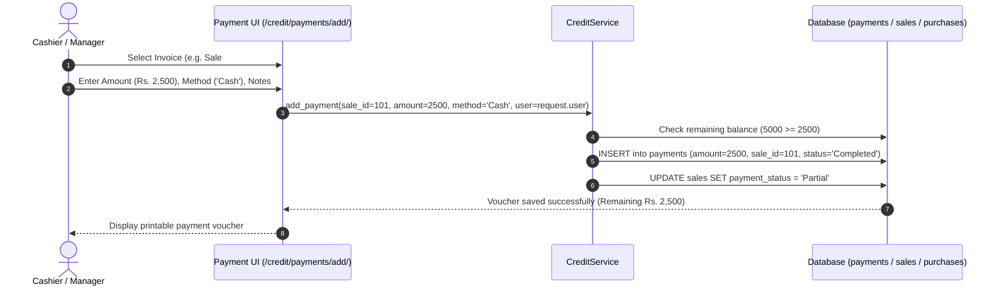

# Feature: Payment Vouchers & Settlement Tracking

> **Identifier**: `FEAT-PAY-001`  
> **Module**: `backend/django_app/apps/sales/models.py` (Payment) & `backend/domain/services/credit_service.py`  
> **Status**: Production Ready  
> **Version**: 1.5.0

---

## 1. Purpose
Provides an immutable financial voucher system for recording all monetary inflows (customer payments) and outflows (supplier settlements, expense disbursements) across Cash, Bank Transfer, QR/Fonepay, and Cheques without mutating inventory stocks.

---

## 2. Scope
- **Included**: Inward customer receipts, outward vendor vouchers, split payments, partial balance settlements, cheque metadata capture, transaction reference tracking, and payment history audit.
- **Out of Scope**: Direct automated bank clearing webhooks (handled via future banking API integrations).

---

## 3. User Roles & Permissions
- **Super Admin & Company Admin**: View, approve, or reverse payment vouchers.
- **Manager**: Issue payment receipts, record supplier payouts, log cheque details.
- **Cashier**: Record cash and QR payments received from customers; print vouchers.

---

## 4. Business Rules
- **Rule PAY-BR-001 (Zero Inventory Mutation)**: Recording a payment voucher settles debt and ledger balances **only**. It must never alter product inventory counts.
- **Rule PAY-BR-002 (Overpayment Prevention)**: A payment recorded against a sale or purchase cannot exceed the outstanding balance (`remaining_amount`) of that specific invoice unless deposited as party unallocated advance.
- **Rule PAY-BR-003 (Status Recalculation)**:
  - If $\sum \text{Payments} \ge \text{Invoice Total} \implies \text{Status = Paid}$.
  - If $0 < \sum \text{Payments} < \text{Invoice Total} \implies \text{Status = Partially Paid}$.
- **Rule PAY-BR-004 (Immutable Audit Trail)**: Every payment voucher records `created_by` (FK to User), timestamp, and generates an `AuditLog` entry.

---

## 5. User Workflow

---

## 6. Database Relationships
- `Payment` (`payments`):
  - Belongs to optional `Sale` (`apps.sales.models.Sale`, `on_delete=models.SET_NULL`).
  - Belongs to optional `Purchase` (`apps.purchases.models.Purchase`, `on_delete=models.SET_NULL`).
  - Belongs to optional `Customer` (`apps.sales.models.Customer`).
  - Belongs to optional `Supplier` (`apps.purchases.models.Supplier`).
  - Belongs to `created_by` (`auth.User`, tracking voucher issuer).

---

## 7. API Endpoints
- `GET /api/v1/credit/payments`: List paginated payment vouchers with method/date filters.
- `POST /api/v1/credit/payments`: Record a new payment voucher against a sale or purchase.
- `GET /api/v1/credit/payments/{id}`: Detailed receipt voucher data.

---

## 8. UI Pages & Components
- **Payment Vouchers Register (`/credit/payments/`)**: Searchable ledger of all settlement transactions with method filter (Cash, Cheque, Bank Transfer, QR).
- **Add Payment Modal & Page (`/credit/payments/add/`)**: Dynamic invoice balance loader, payment method selector, and reference note field.
- **Printable Voucher View**: Compact receipt layout for physical customer signatures.

---

## 9. Notifications & Alerts
- **Payment Received Confirmation**: Instant toast alert with remaining balance indicator.
- **Full Settlement Alert**: Notifies user when an invoice is fully cleared.

---

## 10. Security Considerations
- Prevents payment tampering via immutable voucher records.
- Cross-tenant boundaries ensure vouchers cannot be assigned to another company's invoices.

---

## 11. Validation Rules
- Payment `amount` must be $> 0.00$.
- `payment_date` must not be in the distant future ($> 30\text{ days}$).
- `payment_method` must be one of: `Cash`, `Cheque`, `Bank Transfer`, `Card`, `Online / QR`.

---

## 12. Error Handling
- `ValidationError`: Raised if payment exceeds outstanding balance or amount $\le 0$.
- `NotFoundError`: Raised if targeted sale or purchase invoice does not exist.

---

## 13. Import/Export Behavior
- **Export**: Daily and monthly payment voucher ledgers exportable to CSV and Excel.
- **Audit**: Logged in `ExportLog` upon report download.

---

## 14. Testing Requirements
- Unit tests: `tests/test_credit_management.py::test_partial_payment_sale`, `test_overpayment_prevention`.
- Integration tests: `tests/test_credit_management.py::test_supplier_payment_voucher`.
- Web UI tests: `tests/test_django_web_application.py::test_payment_voucher_list`.

---

## 15. Related Features
- [`receivables-payables.md`](file:///e:/project/Business%20Management%20System/docs/features/receivables-payables.md): Decrements customer and supplier outstanding balances.
- [`cheque-management.md`](file:///e:/project/Business%20Management%20System/docs/features/cheque-management.md): Manages cheque lifecycle when method is Cheque.
- [`sales.md`](file:///e:/project/Business%20Management%20System/docs/features/sales.md): Updates invoice payment status.

---

## 16. Change History
- **2026-09-30 (v1.0.0)**: Basic payment records linked to sales invoices.
- **2026-10-02 (v1.4.0)**: Enhanced with `created_by`, `notes`, `supplier`, `customer` relations in `sales.0002`.
- **2026-10-03 (v1.5.0)**: Standardized to 16-point feature specification.
