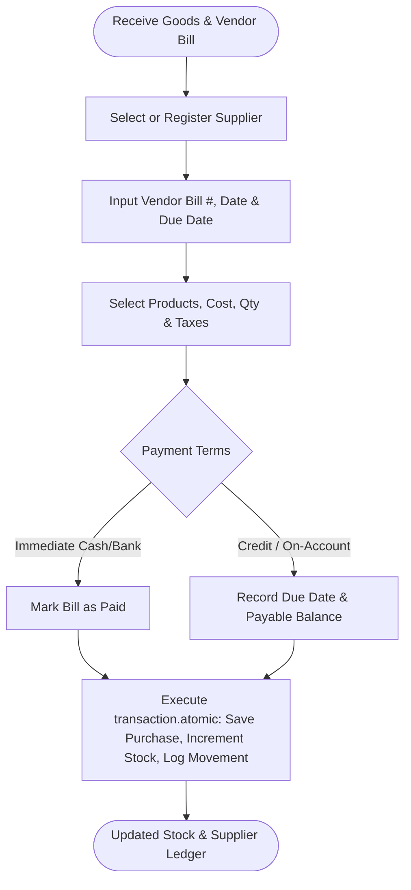

# Feature: Purchase Invoicing & Vendor Management

> **Identifier**: `FEAT-PURCH-001`  
> **Module**: `backend/django_app/apps/purchases` & `backend/domain/services/purchase_service.py`  
> **Status**: Production Ready  
> **Version**: 1.5.0

---

## 1. Purpose
Manages vendor bills, stock replenishment purchase orders, supplier profiles, cost price tracking, and inward inventory increments to maintain continuous business supply chains.

---

## 2. Scope
- **Included**: Supplier master records, vendor bill creation, multi-item purchase receiving, inward stock movement logging, discount/tax calculations, and credit purchase terms.
- **Out of Scope**: Multi-stage procurement RFP approvals and international customs tariff automation.

---

## 3. User Roles & Permissions
- **Super Admin & Company Admin**: Full rights across all purchase orders, supplier contracts, and payment settlements.
- **Manager**: Create, approve, and receive supplier bills; edit vendor master data.
- **Cashier**: Read-only supplier lookup (cannot create purchase orders without manager rights).

---

## 4. Business Rules
- **Rule PURCH-BR-001 (Unique Purchase Number)**: Each purchase order receives an auto-generated purchase number (`PUR-YYYY-XXXX`) and an optional vendor external bill number (`bill_number`).
- **Rule PURCH-BR-002 (Atomic Stock Inward)**: Receiving a purchase bill automatically increments `product.current_stock` and creates `StockMovement` of type `IN` with `reference_type='PURCHASE'`.
- **Rule PURCH-BR-003 (Purchase Price Update)**: Creating a purchase optionally updates the product's default `purchase_price` to the latest procurement cost.
- **Rule PURCH-BR-004 (Payables Status)**:
  - If $\text{paid\_amount} == 0 \implies \text{Status: Due / Unpaid}$.
  - If $0 < \text{paid\_amount} < \text{total} \implies \text{Status: Partial}$.
  - If $\text{paid\_amount} \ge \text{total} \implies \text{Status: Paid}$.
  - If $\text{due\_date} < \text{today} \text{ and } \text{remaining\_amount} > 0 \implies \text{Status: Overdue}$.

---

## 5. User Workflow

---

## 6. Database Relationships
- `Supplier` (`suppliers`): Linked to `Purchase` via Foreign Key (`on_delete=models.SET_NULL`).
- `Purchase` (`purchases`):
  - Foreign Key to `Company` (`companies.Company`).
  - One-to-Many with `PurchaseItem` (`on_delete=models.CASCADE`, related_name `items`).
  - One-to-Many with `Payment` (`on_delete=models.SET_NULL`, related_name `payments`).
- `PurchaseItem` (`purchase_items`): Foreign Key to `inventory.Product` (`on_delete=models.RESTRICT`).

---

## 7. API Endpoints
- `GET /api/v1/purchases/`: List purchase bills with supplier filter, status filter, and pagination.
- `POST /api/v1/purchases/`: Create new purchase invoice and increment stock.
- `GET /api/v1/purchases/{id}`: Detailed purchase breakdown and payment history.
- `GET /api/v1/purchases/suppliers`: List and search vendor profiles.
- `POST /api/v1/purchases/suppliers`: Register new supplier.

---

## 8. UI Pages & Components
- **Purchases Hub (`/purchases/`)**: KPI summary of total purchases, pending supplier bills, and recent orders.
- **Purchase Order Form (`/purchases/create/`)**: Multi-item line entry, vendor bill number, payment terms, and date picker.
- **Purchase Detail View (`/purchases/<id>/`)**: Bill breakdown, goods received audit, and payment voucher history.
- **Supplier Directory (`/purchases/suppliers/`, `/purchases/suppliers/<id>/`)**: Vendor profile, total goods purchased, and payables ledger.

---

## 9. Notifications & Alerts
- **Stock Received Toast**: Flash message confirming stock quantities have been credited to inventory.
- **Upcoming Supplier Due Alert**: Displayed on dashboard 3 days prior to vendor bill `due_date`.

---

## 10. Security Considerations
- Purchases require manager credentials or administrative roles.
- Scoped to active company tenant to isolate sensitive supplier wholesale pricing.

---

## 11. Validation Rules
- Line item `quantity` must be $\ge 1$.
- `unit_price` must be $\ge 0.00$.
- `supplier` must be an active supplier entity.

---

## 12. Error Handling
- `SupplierNotFoundError`: Raised if supplier ID does not exist.
- `InvalidPurchaseDataError`: Raised if line items are missing or values are malformed.

---

## 13. Import/Export Behavior
- **Export**: Export purchase registers to CSV and formatted Excel (.xlsx) via `/purchases/export/excel/`.
- **Import**: Bulk upload vendor product price sheets.

---

## 14. Testing Requirements
- Unit tests: `tests/test_shared_business_logic.py::test_create_purchase`.
- Integration tests: `tests/test_credit_management.py::test_create_credit_taken`.
- Web UI tests: `tests/test_django_web_application.py::test_purchase_list_view`.

---

## 15. Related Features
- [`inventory.md`](file:///e:/project/Business%20Management%20System/docs/features/inventory.md): Receives inward stock movements.
- [`receivables-payables.md`](file:///e:/project/Business%20Management%20System/docs/features/receivables-payables.md): Manages supplier debts and payables ledgers.
- [`payments.md`](file:///e:/project/Business%20Management%20System/docs/features/payments.md): Records cash/bank vouchers paid to suppliers.

---

## 16. Change History
- **2026-09-30 (v1.0.0)**: Initial purchase bill views and supplier tracking.
- **2026-10-02 (v1.4.0)**: Added indexed `due_date` and integrated with `CreditService`.
- **2026-10-03 (v1.5.0)**: Standardized to 16-point feature specification.
