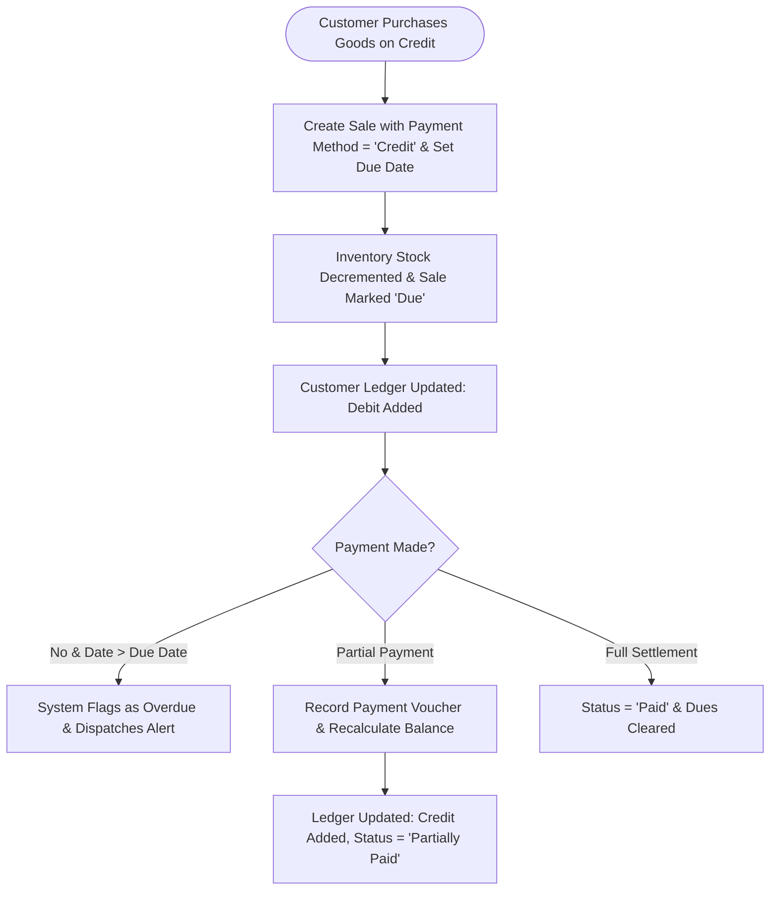

# Feature: Receivables & Payables Management

> **Identifier**: `FEAT-CREDIT-001`  
> **Module**: `backend/django_app/apps/credit` & `backend/domain/services/credit_service.py`  
> **Status**: Production Ready  
> **Version**: 1.8.0

---

## 1. Purpose
Provides a complete, enterprise-grade credit management system to monitor customer receivables, vendor payables, overdue debt detection, and chronological party ledgers with running balances.

---

## 2. Scope
- **Included**: Credit Given (Customer Receivables), Credit Taken (Supplier Payables), Outstanding Dues aggregation, Overdue age analysis, Chronological Party Ledgers with running debit/credit balances, partial payment settlements, and CSV/Excel ledger reporting.
- **Out of Scope**: Third-party debt collection agency automated filing.

---

## 3. User Roles & Permissions
- **Super Admin & Company Admin**: Full visibility over all receivables, bad debt write-offs, and company-wide debt exposure.
- **Manager**: Issue credit sales, record vendor debts, execute partial settlements, view party ledgers, and trigger overdue alerts.
- **Cashier**: View customer credit limits during checkout; record incoming payments (cannot extend unauthorized credit exceeding limit).

---

## 4. Business Rules
- **Rule CRED-BR-001 (Unified Relational Architecture)**: Receivables and Payables utilize the primary `Sale` and `Purchase` tables. They **never** duplicate records into secondary shadow tables.
- **Rule CRED-BR-002 (Real-Time Remaining Balance)**:
  $$\text{Sale.remaining\_amount} = \max(0.00, \text{Sale.total} - \sum \text{Completed Payments})$$
  $$\text{Purchase.remaining\_amount} = \max(0.00, \text{Purchase.total} - \sum \text{Completed Payments})$$
- **Rule CRED-BR-003 (Overdue Debt Calculation)**: An invoice is defined as **Overdue** if and only if:
  $$\text{remaining\_amount} > 0 \quad \text{AND} \quad \text{due\_date} < \text{current\_date}$$
- **Rule CRED-BR-004 (Chronological Running Balance)**:
  - **Customer Ledger**:
    - Debit (+) = New Sale Invoice (Increases amount customer owes).
    - Credit (-) = Payment Received (Decreases amount customer owes).
    - $\text{Running Balance} = \text{Previous Balance} + \text{Debit} - \text{Credit}$.
  - **Supplier Ledger**:
    - Credit (+) = New Purchase Bill (Increases amount owed to supplier).
    - Debit (-) = Payment Disbursed (Decreases amount owed to supplier).
    - $\text{Running Balance} = \text{Previous Balance} + \text{Credit} - \text{Debit}$.

---

## 5. User Workflow

---

## 6. Database Relationships
- Uses `apps.sales.models.Sale` with `due_date` (indexed), `payment_status`, and `total`.
- Uses `apps.purchases.models.Purchase` with `due_date` (indexed), `payment_status`, and `total`.
- Uses `apps.sales.models.Payment` linked to `Sale`, `Purchase`, `Customer`, and `Supplier`.
- Uses `apps.sales.models.Customer` (`credit_limit`, `opening_balance`).
- Uses `apps.purchases.models.Supplier` (`opening_balance`).

---

## 7. API Endpoints
- `GET /api/v1/credit/summary`: Aggregate KPIs (Total Receivables, Total Payables, Net Exposure).
- `GET /api/v1/credit/given`: List all customer credit sales with remaining balances.
- `POST /api/v1/credit/given`: Issue new credit sale with due date and atomic stock decrement.
- `GET /api/v1/credit/taken`: List all supplier credit bills.
- `POST /api/v1/credit/taken`: Record new supplier credit bill with stock increment.
- `POST /api/v1/credit/payments`: Record partial or full settlement payment.
- `GET /api/v1/credit/customers-dues`: List customers with outstanding debt.
- `GET /api/v1/credit/suppliers-dues`: List suppliers with outstanding payables.
- `GET /api/v1/credit/overdue`: List all overdue sales and purchases.
- `GET /api/v1/credit/ledger/customer/{id}`: Chronological customer ledger entries and running balance.
- `GET /api/v1/credit/ledger/supplier/{id}`: Chronological supplier ledger entries and running balance.

---

## 8. UI Pages & Components
- **Receivables & Payables Hub (`/credit/`)**: Financial exposure KPI cards, quick give/take credit buttons, and active dues summary.
- **Credit Given Directory (`/credit/given/`)**: Receivables table with overdue badges, customer filters, and payment action triggers.
- **Credit Taken Directory (`/credit/taken/`)**: Supplier debt table with maturity dates.
- **Customer Dues (`/credit/customers-dues/`)**: Per-customer outstanding debt breakdown with one-click payment launcher.
- **Supplier Dues (`/credit/suppliers-dues/`)**: Per-vendor payable balance summary.
- **Overdue Invoices Center (`/credit/overdue/`)**: Filterable dashboard of delinquent debts with aging buckets.
- **Party Ledger View (`/credit/ledger/customer/<id>/`, `/credit/ledger/supplier/<id>/`)**: Printable statement with date, voucher, debit, credit, and running balance.

---

## 9. Notifications & Alerts
- **Overdue In-App Alert**: Banner alert displayed when delinquent receivables exceed 0.
- **SMS Due Reminder**: Automated SMS trigger to notify customer of approaching or overdue bill.
- **Due Date Warning**: Top navigation alert 2 days prior to invoice maturity.

---

## 10. Security Considerations
- Cashiers cannot extend credit if customer's total unpaid debt exceeds `customer.credit_limit`.
- Atomic database transactions guarantee ledger balance consistency.
- Company scoping enforced on all endpoints and queries.

---

## 11. Validation Rules
- `due_date` must not be before `sale_date` or `purchase_date`.
- Partial payment cannot exceed `remaining_amount`.
- Credit cannot be issued to an inactive customer or supplier.

---

## 12. Error Handling
- `ValidationError`: Raised if payment amount is invalid or zero.
- `CreditLimitExceededError`: Raised if customer debt exceeds limit.
- `InvoiceAlreadySettledError`: Raised if attempting payment on a fully paid invoice.

---

## 13. Import/Export Behavior
- **Export**: One-click CSV and Excel export of customer dues, supplier dues, overdue invoices, and party ledger statements via `/credit/reports/export/csv/`.

---

## 14. Testing Requirements
- Unit tests: `tests/test_credit_management.py` (19 automated tests):
  - `test_create_credit_given`
  - `test_create_credit_taken`
  - `test_partial_payment_sale`
  - `test_prevent_overpayment`
  - `test_customer_ledger_running_balance`
  - `test_supplier_ledger_running_balance`
  - `test_overdue_detection`
  - `test_credit_summary_kpi`

---

## 15. Related Features
- [`sales.md`](file:///e:/project/Business%20Management%20System/docs/features/sales.md): Generates receivables.
- [`purchases.md`](file:///e:/project/Business%20Management%20System/docs/features/purchases.md): Generates payables.
- [`payments.md`](file:///e:/project/Business%20Management%20System/docs/features/payments.md): Settles outstanding amounts.
- [`sms.md`](file:///e:/project/Business%20Management%20System/docs/features/sms.md): Dispatches overdue notifications.

---

## 16. Change History
- **2026-10-02 (v1.4.0)**: Initial design and complete implementation of Udhaar / Credit Management.
- **2026-10-03 (v1.5.0)**: Standardized to 16-point feature specification.
