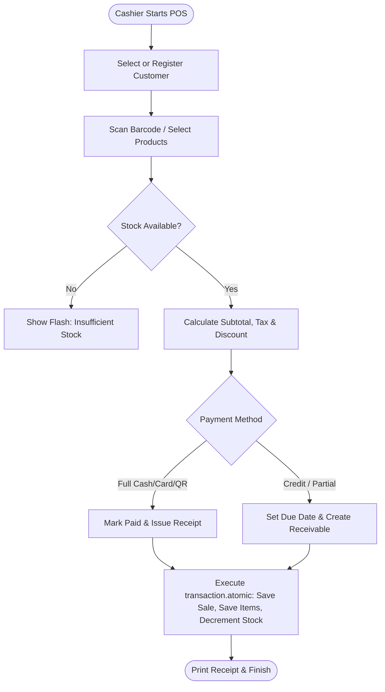

# Feature: Sales Invoicing & POS Operations

> **Identifier**: `FEAT-SALE-001`  
> **Module**: `backend/django_app/apps/sales` & `backend/domain/services/sale_service.py`  
> **Status**: Production Ready  
> **Version**: 1.5.0

---

## 1. Purpose
Empowers cashiers and managers to execute retail sales, generate formal tax invoices, calculate line-item discounts and VAT/taxes, handle instant cash/card settlements, and ensure atomic stock decrements.

---

## 2. Scope
- **Included**: Customer master management, multi-item invoice creation, subtotal/tax/discount mathematical engine, POS receipt thermal printing, payment method recording (Cash, Card, QR, Cheque, Credit), and sales transaction history.
- **Out of Scope**: Multi-store split-tender escrow (managed via Payment & Credit modules).

---

## 3. User Roles & Permissions
- **Super Admin & Company Admin**: View, create, void, and export all sales records across the company.
- **Manager**: Create, view, edit invoices, issue customer credits, and print tax reports.
- **Cashier**: Create sales, record cash/card payments, print receipts (cannot void without manager override).

---

## 4. Business Rules
- **Rule SALE-BR-001 (Invoice Numbering)**: Every sale must have an auto-generated, sequential, gapless invoice number per tenant company (`INV-YYYY-XXXX`).
- **Rule SALE-BR-002 (Atomic Stock Decrement)**: Submitting a sales invoice must decrement stock for all line items within a `transaction.atomic()` block.
- **Rule SALE-BR-003 (Financial Calculation)**:
  $$\text{Subtotal} = \sum (\text{item.quantity} \times \text{item.unit\_price})$$
  $$\text{Line Total} = (\text{item.quantity} \times \text{item.unit\_price}) - \text{item.discount} + \text{item.tax}$$
  $$\text{Grand Total} = \text{Subtotal} - \text{Invoice Discount} + \text{Invoice Tax}$$
- **Rule SALE-BR-004 (Payment Status Sync)**:
  - If $\text{paid\_amount} == 0 \implies \text{Status: Due / Unpaid}$.
  - If $0 < \text{paid\_amount} < \text{total} \implies \text{Status: Partial}$.
  - If $\text{paid\_amount} \ge \text{total} \implies \text{Status: Paid}$.
  - If $\text{due\_date} < \text{today} \text{ and } \text{remaining\_amount} > 0 \implies \text{Status: Overdue}$.

---

## 5. User Workflow

---

## 6. Database Relationships
- `Customer` (`customers`): Linked to `Sale` via Foreign Key (`on_delete=models.SET_NULL`).
- `Sale` (`sales`):
  - Foreign Key to `Company` (`companies.Company`).
  - One-to-Many with `SaleItem` (`on_delete=models.CASCADE`, related_name `items`).
  - One-to-Many with `Payment` (`on_delete=models.SET_NULL`, related_name `payments`).
- `SaleItem` (`sale_items`): Foreign Key to `inventory.Product` (`on_delete=models.RESTRICT`).

---

## 7. API Endpoints
- `GET /api/v1/sales/`: List sales invoices with date ranges, customer filtering, and pagination.
- `POST /api/v1/sales/`: Create new sales invoice with nested line items.
- `GET /api/v1/sales/{id}`: Detailed invoice breakdown with items and payment history.
- `GET /api/v1/sales/customers`: List and search customer master records.
- `POST /api/v1/sales/customers`: Register new customer with credit limit.

---

## 8. UI Pages & Components
- **Sales Hub (`/sales/`)**: KPI summary cards, quick POS button, and paginated invoice table with status badges.
- **POS / Invoice Creator (`/sales/create/`)**: Dynamic JavaScript line-item adder, product search autocomplete, live total calculations, and payment drawer.
- **Invoice Detail & Thermal Receipt (`/sales/<id>/`)**: Printable A4 and 80mm thermal receipt views.
- **Customer Directory (`/sales/customers/`, `/sales/customers/<id>/`)**: Profile, total purchases, outstanding credit, and ledger shortcut.

---

## 9. Notifications & Alerts
- **Successful Sale Toast**: Instant UI toast confirming invoice creation and stock update.
- **Credit Sale Alert**: If payment method is Credit, an entry is queued to the receivables ledger.
- **Overdue Payment Alert**: Queued for daily reminder if unpaid past `due_date`.

---

## 10. Security Considerations
- Cashiers cannot alter price below product `purchase_price` without manager override.
- Strict company-level filtering prevents cross-tenant data leakage.
- CSRF validation enforced on all checkout transactions.

---

## 11. Validation Rules
- Line item `quantity` must be an integer $> 0$.
- Line item `unit_price` must be $\ge 0.00$.
- `discount` cannot exceed line subtotal.
- If payment method is `Credit`, `due_date` is mandatory.

---

## 12. Error Handling
- `InsufficientStockError`: Thrown if any line item quantity exceeds available stock (HTTP 400).
- `CustomerCreditLimitExceeded`: Thrown if customer outstanding balance + new sale exceeds `credit_limit`.
- `InvalidPaymentAmountError`: Thrown if paid amount is negative or invalid.

---

## 13. Import/Export Behavior
- **Export**: Invoice list exportable to CSV and styled Excel (`.xlsx`) via `/sales/export/excel/`.
- **Receipt Print**: Formatted thermal receipt generation and PDF export.

---

## 14. Testing Requirements
- Unit tests: `tests/test_shared_business_logic.py::test_create_sale`, `test_invoice_calculations`.
- Integration tests: `tests/test_credit_management.py::test_create_credit_given`.
- Web UI tests: `tests/test_django_web_application.py::test_sales_create_view`.

---

## 15. Related Features
- [`inventory.md`](file:///e:/project/Business%20Management%20System/docs/features/inventory.md): Validates availability and decrements stock.
- [`receivables-payables.md`](file:///e:/project/Business%20Management%20System/docs/features/receivables-payables.md): Manages credit invoices and ledger tracking.
- [`payments.md`](file:///e:/project/Business%20Management%20System/docs/features/payments.md): Records payment settlements against invoices.

---

## 16. Change History
- **2026-09-30 (v1.0.0)**: Initial sales views, customer profiles, and invoice generation.
- **2026-10-02 (v1.4.0)**: Integrated with `CreditService` and added indexed `due_date` property.
- **2026-10-03 (v1.5.0)**: Standardized to 16-point feature specification.
