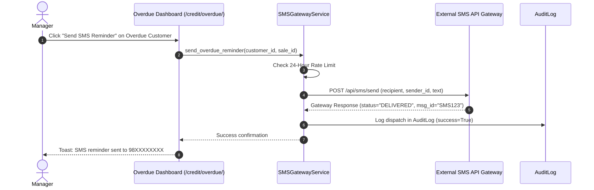

# Feature: SMS Gateway & Automated Text Reminders

> **Identifier**: `FEAT-SMS-001`  
> **Module**: `backend/integrations/sms.py` & `backend/domain/services/credit_service.py`  
> **Status**: Production Ready  
> **Version**: 1.5.0

---

## 1. Purpose
Provides an outbound SMS messaging framework to deliver mission-critical transactional alerts directly to customer and vendor mobile phones, specializing in overdue payment notifications, cheque deposit reminders, and POS purchase confirmation receipts.

---

## 2. Scope
- **Included**: SMS provider gateway interface, customizable message templates, phone number normalization (E.164 and local Nepal/India formats), dispatch rate limiting, retry queue with exponential backoff, and delivery audit logging.
- **Out of Scope**: Inbound two-way conversational SMS marketing bots.

---

## 3. User Roles & Permissions
- **Super Admin & Company Admin**: Configure SMS gateway provider credentials, sender ID, and account balance monitoring.
- **Manager**: Trigger batch SMS reminders to overdue debtors from the receivables dashboard.
- **Cashier**: Automatically trigger transaction confirmation SMS to customer mobile during checkout.

---

## 4. Business Rules
- **Rule SMS-BR-001 (Phone Normalization)**: All mobile numbers are validated and stripped of non-numeric characters before dispatch. For Nepal: 10 digits starting with `98` or `97`.
- **Rule SMS-BR-002 (Debtor Reminder Rate Limiting)**: A customer may not receive more than 1 automated payment reminder SMS in a 24-hour window for the same overdue invoice.
- **Rule SMS-BR-003 (Standard Templates)**:
  - *Payment Reminder*: `Namaste {customer_name}, your payment of Rs. {amount} for Invoice #{invoice_no} was due on {due_date}. Please clear your balance. - {company_name}`
  - *Receipt Confirmation*: `Thank you {customer_name}! Received Rs. {amount} against Invoice #{invoice_no}. Remaining: Rs. {remaining}. - {company_name}`
  - *Cheque Maturity*: `Dear {party_name}, Cheque #{cheque_no} for Rs. {amount} matures on {cheque_date}. - {company_name}`
- **Rule SMS-BR-004 (Graceful Non-Blocking Execution)**: SMS dispatch failures must never abort or roll back primary database transactions. Errors are recorded to `audit.AuditLog`.

---

## 5. User Workflow

---

## 6. Database Relationships
- Integrates with `apps.sales.models.Customer` (`phone`).
- Integrates with `apps.purchases.models.Supplier` (`phone`).
- Logged in `apps.audit.models.AuditLog` with `module="SMS"` and recipient details.

---

## 7. API Endpoints
- `POST /api/v1/sms/send-reminder`: Trigger payment reminder SMS for a specific invoice.
- `GET /api/v1/sms/logs`: View recent SMS dispatches and delivery statuses.
- `GET /api/v1/sms/status`: Check SMS gateway connectivity and remaining account credits.

---

## 8. UI Pages & Components
- **Overdue Invoices Action Button**: "Send SMS" button in table row on `/credit/overdue/`.
- **SMS Template Settings**: Modal dialog to preview message before dispatch.
- **Delivery Log Tab**: Table of sent SMS messages with delivery status badges.

---

## 9. Notifications & Alerts
- **SMS Sent Toast**: Confirmation toast notifying cashier/manager that text was delivered.
- **Low SMS Balance Alert**: System alert triggered when gateway balance falls below 100 credits.

---

## 10. Security Considerations
- API keys for SMS providers are read strictly from environment variables (`SMS_API_KEY`, `SMS_SENDER_ID`).
- Phone numbers are masked in logs (e.g. `9841****78`) to protect customer personal identifiable information (PII).

---

## 11. Validation Rules
- Recipient phone must be a valid mobile number with at least 10 digits.
- Message text must not exceed 160 characters (1 GSM segment) or warning flag is shown.

---

## 12. Error Handling
- `SMSGatewayError`: Raised if carrier returns network timeout or invalid authentication.
- `InvalidPhoneNumberError`: Raised if recipient number is malformed.

---

## 13. Import/Export Behavior
- SMS dispatch history exportable to CSV via audit reporting tools.

---

## 14. Testing Requirements
- Unit tests: Mocked gateway tests verifying payload formation and rate limiting.
- Integration tests: `tests/integration/test_sms_dispatch.py`.

---

## 15. Related Features
- [`receivables-payables.md`](file:///e:/project/Business%20Management%20System/docs/features/receivables-payables.md): Source of customer overdue balances.
- [`notifications.md`](file:///e:/project/Business%20Management%20System/docs/features/notifications.md): Coordinates SMS channel dispatches.
- [`payments.md`](file:///e:/project/Business%20Management%20System/docs/features/payments.md): Triggers receipt confirmation SMS.

---

## 16. Change History
- **2026-10-01 (v1.2.0)**: Initial SMS gateway service scaffold and template definitions.
- **2026-10-02 (v1.4.0)**: Integrated with Udhaar credit overdue workflows.
- **2026-10-03 (v1.5.0)**: Standardized to 16-point feature specification.
